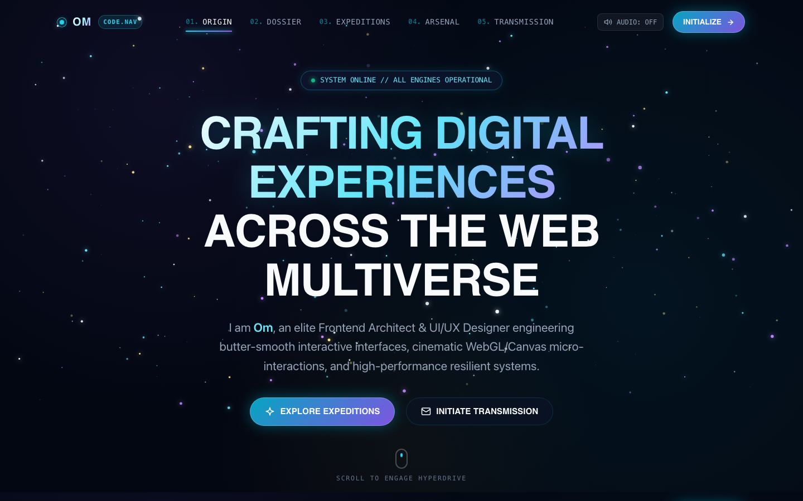

# 🌌 Deep Cosmos // Space Theme Portfolio

An elite, cinematic, single-page portfolio engineered with **React.js, Vite, Tailwind CSS, Framer Motion, and HTML5 Canvas**.



---

## 🚀 Key Features

1. **Header & Navigation**:
   - **Primary Brand Emblem**: Top-left position with dynamic pulsing pulsar dot (`OM // CODE.NAV`).
   - **Adaptive Sticky Header**: Transitions from transparent to frosted glassmorphism on scroll, scaling down height and intensifying the neon starlight glow.
   - **Telemetry Section Navigation**: Smooth scrolling with active section indicator tracking.
   - **Synthesizer Audio Toggle**: Interactive sci-fi sound effects synthesized directly using the Web Audio API.

2. **Hero Canvas & Starfield Engine**:
   - **Dynamic HTML5 Canvas**: 250+ multi-spectral stars (white, cyan, violet, amber) with sinusoidal twinkling.
   - **Gravitational Cursor Reaction**: Stars react elastically to pointer motion with magnetic pull and spring damping.
   - **Constellation Scroll (Warp Speed)**: Real-time scroll velocity detection stretches stars into luminous hyperdrive streaks between sections.
   - **Cosmic Meteors**: Occasional shooting stars streaking across the celestial horizon.

3. **Sections**:
   - **Hero**: Kinetic holographic typography, operational status badge, dual CTAs, and scroll indicator.
   - **About Me (Astronaut Dossier)**: Flight commander avatar with orbiting rings, personal narrative, and 4 animated orbital metric counters.
   - **Projects (Floating Nebula Capsules)**: 3D cursor tilt with spring physics, dynamic mouse spotlight radial border illumination, sector badges, category filter tabs (`All Systems`, `Web`, `Creative & 3D`, `AI`), and deployment links.
   - **Skills (Reactor Cores)**: Categorized into 4 orbital command clusters with animated energy gauge bars.
   - **Contact (Subspace Transmission Relay)**: Interstellar contact terminal with 1-click clipboard frequency copy and interactive message transmission feedback.
   - **Footer**: Galactic stardate clock and propulsion back-to-top jump button.

---

## 📂 Project Structure

```
Portfolio.html/
├── index.html                   # Runnable standalone single-page portfolio
├── css/
│   └── styles.css               # Cosmic design system & glassmorphism engine
├── js/
│   ├── canvas.js                # HTML5 Canvas starfield & warp drive engine
│   └── main.js                  # 3D tilt, spotlight, audio synth & interactions
├── assets/                      # Viewport screenshots and illustrations
├── src/                         # Modular React + Vite + Tailwind source
│   ├── components/
│   │   ├── canvas/              # SpaceCanvasBackground.tsx
│   │   ├── layout/              # Navbar.tsx, Footer.tsx
│   │   └── sections/            # Hero, About, Projects, Skills, Contact
│   ├── data/portfolioData.ts    # Centralized portfolio data
│   ├── App.tsx                  # Master React orchestrator
│   └── main.tsx                 # React DOM mount point
├── package.json                 # Dependencies & scripts
├── vite.config.ts               # Vite configuration
└── tailwind.config.js           # Tailwind configuration
```

---

## 💻 How to View & Run

### Instant Browser Preview (No installation required)
Double-click `index.html` or open it directly in Google Chrome / Safari:
```bash
open index.html
```

### React & Vite Development Server
```bash
npm install
npm run dev
```
Open `http://localhost:3000` to view the live hot-reloading development server.

